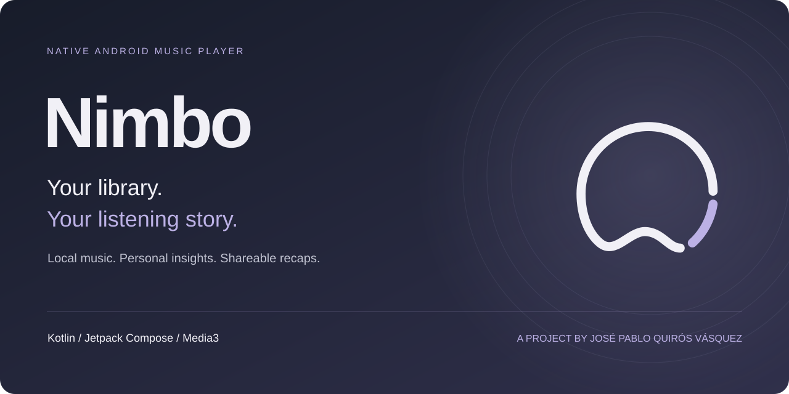

# Nimbo

**A native Android music player that turns a local library into a personal listening experience.**

Browse music on your phone and SD card, shape the player around your taste, and revisit your listening through statistics and shareable monthly stories.

**Kotlin · Jetpack Compose · Media3 · SQLite · Python / Flask**

[Product tour](docs/PRODUCT_TOUR.md) · [Architecture](docs/ARCHITECTURE.md) · [Engineering decisions](docs/ENGINEERING.md) · [Validation](docs/VALIDATION.md)

## The experience

  
  &nbsp;
  
  &nbsp;
  

Player · Listening insights · Personalization. Actual app renders with fictional test data; versions and accessibility settings are documented in the <a href="docs/assets/README.md">asset guide</a>.

## Why I built it

A music collection is more than a list of files. I wanted a player that gives local music the care of a personal collection: useful organization, reliable background playback, expressive visual choices, and a way to look back at what you listened to.

My work spans the Android interface, playback service, local persistence, listening analytics, recap rendering and export, and the account and statistical backup API. The reviewed release is **0.8.0**, targeting Android 10 and later.

## What it does

| Area | Capabilities |
| --- | --- |
| Library | MediaStore discovery, phone and SD storage, search, albums, artists, genres, folders, favorites, and bulk selection. |
| Playback | Background playback, media notification, queue, shuffle, repeat, sleep timer, and audio focus through Media3. |
| Playlists | Reorder and remove individual occurrences, including repeated songs, with undo support. |
| Personalization | Theme presets, artwork palettes, wallpapers, blur and opacity, typography, and artwork variants per theme. |
| Metadata and lyrics | Local metadata and cover edits; lyrics matching, candidate review, and controlled web-copy assistance. Original audio tags are preserved. |
| Listening insights | Account-separated history, monthly and yearly summaries, song and artist rankings, and actual listening time. |
| Monthly stories | Seven recap cards, frozen monthly snapshots, PNG sharing, and MP4 export with an independent soundtrack. |
| Accounts and backup | Accounts, statistical restoration, and daily backup, with durable retries and checks against stale sessions and revisions. |

Audio playback uses files on the device. Account access and remote backup require connectivity; lyrics lookup uses an external service. Statistical backups contain listening data and minimal metadata, while audio, lyrics, artwork, and file paths stay outside those backups.

## A closer look

  
  &nbsp;
  

Monthly stories use a shared artboard for on-screen rendering and exported media. Their soundtrack plays separately from the main player, so previewing a recap does not add listening time to your statistics.

[Explore the full visual tour →](docs/PRODUCT_TOUR.md)

## Engineering behind the experience

- **Playback outlives the screen.** A Media3 playback service owns the player and session, keeping screen navigation separate from the audio lifecycle.
- **Retries preserve the original operation.** A pending statistical backup is stored before sending and retried unchanged until acknowledged. Owner, device, month, revision, and generation checks protect account boundaries.
- **Listening time follows playback.** A monotonic clock measures active listening, excluding pauses and seek jumps. Recap samples use a separate audio path.
- **Local edits preserve relationships.** SQLite updates retain playlist occurrences and artwork associations; lyrics updates check expected fields before saving over concurrent changes.

[Read the decisions and tradeoffs →](docs/ENGINEERING.md)

## Technology

| Layer | Used in the project |
| --- | --- |
| Android | Kotlin 2.2.20, Jetpack Compose, Material 3, coroutines |
| Media | Media3 1.8.0: ExoPlayer, MediaSession, Transformer and effects |
| Device integration | MediaStore, WorkManager, Android Keystore, Canvas / Bitmap |
| Persistence | SQLite / SQLiteOpenHelper, SharedPreferences |
| API | Python 3.13, Flask, Gunicorn, PyMySQL, MySQL 8.4 |
| Delivery | Gradle, Docker, GitHub Actions |
| Quality | JUnit, Robolectric, Compose tests, Android instrumentation, Python unittest, ktfmt, Ruff |

## Validation

The reviewed private-source CI run passed **158 Android unit/Robolectric tests and 12 Python tests**. Formatting, Android lint, and the debug build also passed. Lint reported no errors and 63 warnings per variant. These results describe the reviewed source revision, rather than a workflow running in this documentation repository.

[Evidence, test scope, and remaining limitations →](docs/VALIDATION.md)

## About this repository

This is a public portfolio case study with an independent documentation history. Application source, operational configuration, signing material, and release binaries are maintained separately in a private repository.

Lyrics lookup integrates [LRCLIB](https://lrclib.net/). The screenshots use fictional fixtures and original placeholder artwork; this repository does not redistribute a music or lyrics catalog. See [asset provenance](docs/assets/README.md) and [copyright](COPYRIGHT.md).

**José Pablo Quirós Vásquez** · [GitHub](https://github.com/jquirosv) · [LinkedIn](https://www.linkedin.com/in/jquirosv/)

Leer en español

### Tu biblioteca. Tu historia musical.

Nimbo es un reproductor nativo para Android que combina música local, personalización y estadísticas de escucha. Permite organizar archivos del teléfono y la tarjeta SD, escuchar en segundo plano, editar información local y consultar letras con revisión de resultados.

Desarrollé la interfaz con Kotlin y Jetpack Compose, la reproducción con Media3, la persistencia SQLite y la API de cuentas y respaldos con Python, Flask y MySQL. Los respaldos incluyen estadísticas y metadatos mínimos; el audio, las letras, las portadas y las rutas no forman parte del respaldo remoto.

Los resúmenes mensuales tienen siete historias y se comparten como imágenes o video. Su audio es independiente del reproductor y no altera las estadísticas. La personalización incluye temas, tipografías, fondos y portadas por tema, junto con adaptaciones para texto grande, orientación horizontal y movimiento reducido.

La revisión de CI del código privado aprobó 158 pruebas Android y 12 de Python. Este repositorio presenta el producto, su arquitectura, decisiones técnicas y evidencia visual; el código de la aplicación se mantiene privado.

