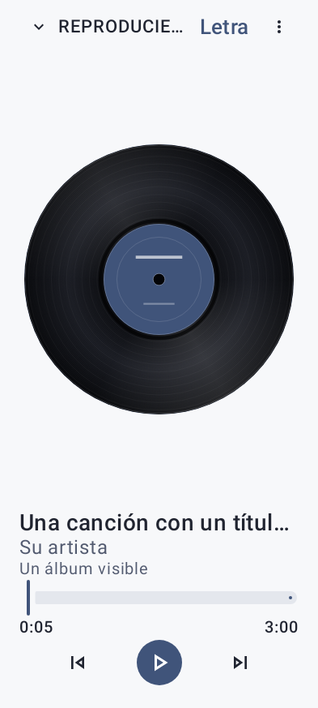
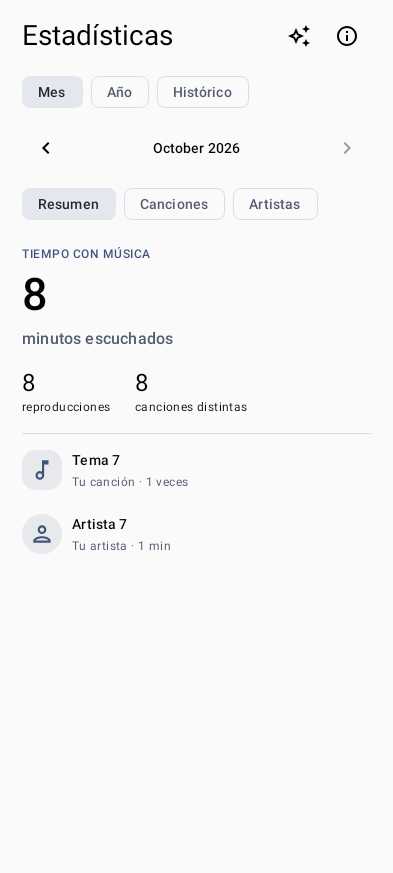
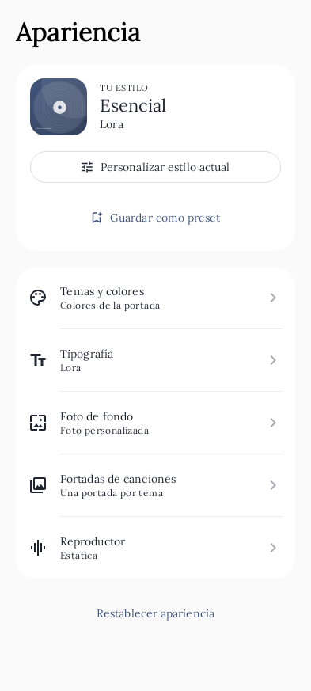
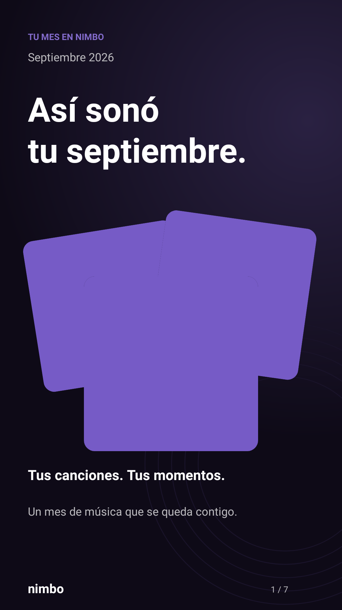
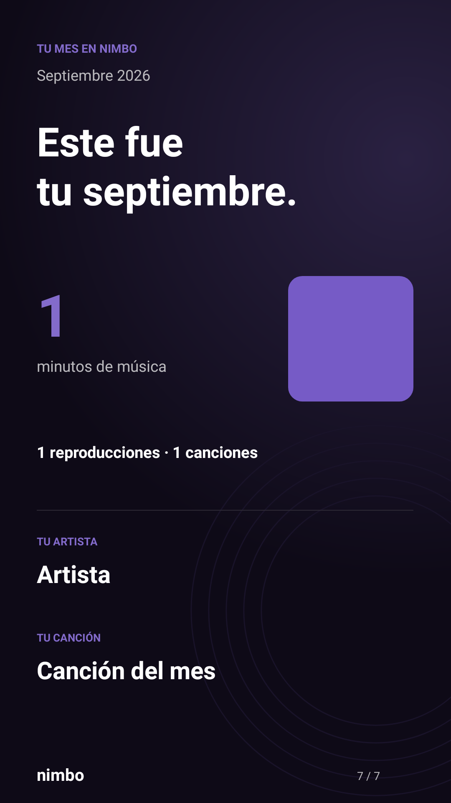

# Nimbo Player

**A native Android music player that turns a local library into a personal listening experience.**

Browse music on your phone and SD card, shape the player around your taste, and revisit your listening through statistics and shareable monthly stories.

**Kotlin · Jetpack Compose · Media3 · SQLite · Python / Flask**

**0.8.1 update:** the app is now **Nimbo Player**. The original sound halo gains a central vinyl ring, with the new name reflected in Android, onboarding, monthly stories, and exports.

[Product tour](docs/PRODUCT_TOUR.md) · [Architecture](docs/ARCHITECTURE.md) · [Engineering decisions](docs/ENGINEERING.md) · [Validation](docs/VALIDATION.md) · [Español](#español)

## The experience

  
  &nbsp;
  
  &nbsp;
  

Player · Listening insights · Personalization. Actual app renders with fictional test data; versions and accessibility settings are documented in the <a href="docs/assets/README.md">asset guide</a>.

## Why I built it

A music collection is more than a list of files. I wanted a player that gives local music the care of a personal collection: useful organization, reliable background playback, expressive visual choices, and a way to look back at what you listened to.

My work spans the Android interface, playback service, local persistence, listening analytics, recap rendering and export, and the account and statistical backup API. The current reviewed version is **0.8.1**, targeting Android 10 and later.

## What it does

| Area | Capabilities |
| --- | --- |
| Library | MediaStore discovery, phone and SD storage, search, albums, artists, genres, folders, favorites, and bulk selection. |
| Playback | Background playback, media notification, queue, shuffle, repeat, sleep timer, and audio focus through Media3. |
| Playlists | Reorder and remove individual occurrences, including repeated songs, with undo support. |
| Personalization | Theme presets, artwork palettes, wallpapers, blur and opacity, typography, and artwork variants per theme. |
| Metadata and lyrics | Local metadata and cover edits; lyrics matching, candidate review, and controlled web-copy assistance. Original audio tags are preserved. |
| Listening insights | Account-separated history, monthly and yearly summaries, song and artist rankings, and actual listening time. |
| Monthly stories | Seven recap cards, frozen monthly snapshots, PNG sharing, and MP4 export with an independent soundtrack. |
| Accounts and backup | Accounts, statistical restoration, and daily backup, with durable retries and checks against stale sessions and revisions. |

Audio playback uses files on the device. Account access and remote backup require connectivity; lyrics lookup uses an external service. Statistical backups contain listening data and minimal metadata, while audio, lyrics, artwork, and file paths stay outside those backups.

## A closer look

  
  &nbsp;
  

Monthly stories use a shared artboard for on-screen rendering and exported media. Their soundtrack plays separately from the main player, so previewing a recap does not add listening time to your statistics.

[Explore the full visual tour →](docs/PRODUCT_TOUR.md)

## Engineering behind the experience

- **Playback outlives the screen.** A Media3 playback service owns the player and session, keeping screen navigation separate from the audio lifecycle.
- **Retries preserve the original operation.** A pending statistical backup is stored before sending and retried unchanged until acknowledged. Owner, device, month, revision, and generation checks protect account boundaries.
- **Listening time follows playback.** A monotonic clock measures active listening, excluding pauses and seek jumps. Recap samples use a separate audio path.
- **Local edits preserve relationships.** SQLite updates retain playlist occurrences and artwork associations; lyrics updates check expected fields before saving over concurrent changes.

[Read the decisions and tradeoffs →](docs/ENGINEERING.md)

## Technology

| Layer | Used in the project |
| --- | --- |
| Android | Kotlin 2.2.20, Jetpack Compose, Material 3, coroutines |
| Media | Media3 1.8.0: ExoPlayer, MediaSession, Transformer and effects |
| Device integration | MediaStore, WorkManager, Android Keystore, Canvas / Bitmap |
| Persistence | SQLite / SQLiteOpenHelper, SharedPreferences |
| API | Python 3.13, Flask, Gunicorn, PyMySQL, MySQL 8.4 |
| Delivery | Gradle, Docker, GitHub Actions |
| Quality | JUnit, Robolectric, Compose tests, Android instrumentation, Python unittest, ktfmt, Ruff |

## Validation

The inspected **0.8.0 baseline** CI run passed **158 Android unit/Robolectric tests and 12 Python tests**. Formatting, Android lint, and the debug build also passed. Lint reported no errors and 63 warnings per variant. The 0.8.1 review covers the branding and version changes; its validation is documented separately below. This documentation repository does not run the application's tests.

[Evidence, test scope, and remaining limitations →](docs/VALIDATION.md)

## About this repository

This is a public portfolio case study with an independent documentation history. Application source, operational configuration, signing material, and release binaries are maintained separately in a private repository.

Lyrics lookup integrates [LRCLIB](https://lrclib.net/). The screenshots use fictional fixtures and original placeholder artwork; this repository does not redistribute a music or lyrics catalog. See [asset provenance](docs/assets/README.md) and [copyright](COPYRIGHT.md).

**José Pablo Quirós Vásquez** · [GitHub](https://github.com/jquirosv) · [LinkedIn](https://www.linkedin.com/in/jquirosv/)

## Español

Español — presentación completa

## Nimbo Player en español

**Un reproductor nativo para Android que convierte tu biblioteca local en una experiencia musical personal.**

Explora la música de tu teléfono y tarjeta SD, adapta el reproductor a tu estilo y redescubre tus escuchas con estadísticas e historias mensuales para compartir.

**Kotlin · Jetpack Compose · Media3 · SQLite · Python / Flask**

**Actualización 0.8.1:** la aplicación ahora se llama **Nimbo Player**. El halo original incorpora un anillo central de vinilo y el nombre se actualiza en Android, la bienvenida, las historias mensuales y las exportaciones.

[Recorrido del producto](docs/PRODUCT_TOUR.md) · [Arquitectura](docs/ARCHITECTURE.md) · [Decisiones técnicas](docs/ENGINEERING.md) · [Validación](docs/VALIDATION.md). Documentación ampliada en inglés.

### La experiencia

  
  &nbsp;
  
  &nbsp;
  

Reproducción, estadísticas y personalización. Son renders reales de la aplicación con datos ficticios de prueba; las versiones y los ajustes de accesibilidad están identificados en la [guía de imágenes](docs/assets/README.md).

### Por qué lo desarrollé

Una colección musical es más que una lista de archivos. Quise crear un reproductor que cuide esa colección: organización útil, reproducción fiable en segundo plano, opciones visuales personales y una forma de recordar lo que escuchaste.

Mi trabajo abarca la interfaz Android, el servicio de reproducción, la persistencia local, las estadísticas, la composición y exportación de resúmenes y la API de cuentas y respaldos estadísticos. La versión actual revisada es **0.8.1**, para **Android 10 y posteriores**.

### Funcionalidades

| Área | Capacidades |
| --- | --- |
| Biblioteca | Detección mediante MediaStore, teléfono y tarjeta SD, búsqueda, álbumes, artistas, géneros, carpetas, favoritos y selección múltiple. |
| Reproducción | Segundo plano, notificación multimedia, cola, aleatorio, repetición, temporizador y gestión del foco de audio mediante Media3. |
| Listas | Reordenación y eliminación de ocurrencias individuales, incluidas canciones repetidas, con opción de deshacer. |
| Personalización | Temas, paletas basadas en portadas, fondos, desenfoque, opacidad, tipografías y variantes de portada por tema. |
| Metadatos y letras | Edición local de información y portadas; búsqueda de letras, revisión de candidatos y asistencia de copia web acotada. Conserva las etiquetas del archivo de audio original. |
| Estadísticas | Historial separado por cuenta, resúmenes mensuales y anuales, clasificaciones de canciones y artistas y tiempo real de escucha. |
| Historias mensuales | Siete tarjetas, instantáneas mensuales conservadas, imágenes PNG y video MP4 con audio independiente. |
| Cuentas y respaldos | Cuentas, restauración de estadísticas y respaldo diario con reintentos persistentes y comprobaciones de sesión y revisión. |

La reproducción utiliza archivos del dispositivo. Las cuentas y los respaldos remotos necesitan conexión; la consulta de letras utiliza un servicio externo. Los respaldos contienen estadísticas y metadatos mínimos: el audio, las letras, las portadas y las rutas de archivos quedan fuera de ellos.

### Una mirada más cercana

  
  &nbsp;
  

Las historias comparten una misma composición gráfica para la vista en pantalla y la exportación. Su banda sonora se reproduce por separado del reproductor principal, de modo que consultar un resumen no añade tiempo de escucha a tus estadísticas.

[Ver el recorrido visual completo →](docs/PRODUCT_TOUR.md)

### Ingeniería detrás de la experiencia

- **La reproducción continúa fuera de la pantalla.** El servicio Media3 controla el reproductor y su sesión, separando la navegación del ciclo de vida del audio.
- **Los reintentos conservan la operación original.** El respaldo pendiente se guarda antes de enviarse y se reintenta sin cambiar su contenido hasta recibir confirmación. Se comprueban propietario, dispositivo, mes, revisión y generación.
- **El tiempo de escucha sigue la reproducción.** Un reloj monotónico mide los intervalos activos, sin contar pausas ni saltos de posición. Los fragmentos de los resúmenes usan otro circuito de audio.
- **Las ediciones conservan las relaciones.** Las actualizaciones SQLite mantienen las ocurrencias de listas y asociaciones de portadas; el guardado de letras comprueba los campos esperados para proteger cambios concurrentes.

[Decisiones y compromisos técnicos →](docs/ENGINEERING.md)

### Tecnologías

| Capa | Tecnologías utilizadas |
| --- | --- |
| Android | Kotlin 2.2.20, Jetpack Compose, Material 3 y coroutines |
| Multimedia | Media3 1.8.0: ExoPlayer, MediaSession, Transformer y efectos |
| Integración con el dispositivo | MediaStore, WorkManager, Android Keystore y Canvas / Bitmap |
| Persistencia | SQLite / SQLiteOpenHelper y SharedPreferences |
| API | Python 3.13, Flask, Gunicorn, PyMySQL y MySQL 8.4 |
| Entrega | Gradle, Docker y GitHub Actions |
| Calidad | JUnit, Robolectric, pruebas Compose, instrumentación Android, unittest de Python, ktfmt y Ruff |

### Validación

La ejecución de integración continua inspeccionada de la **base 0.8.0** aprobó **158 pruebas Android unitarias/Robolectric y 12 pruebas Python**. También se aprobaron el formato, Android lint y la compilación debug. Lint registró cero errores y 63 advertencias por variante. La revisión 0.8.1 cubre la marca y el cambio de versión, con su validación documentada por separado. Este repositorio de presentación no ejecuta las pruebas de la aplicación.

[Evidencia, alcance y limitaciones →](docs/VALIDATION.md)

### Acerca de este repositorio

Esta es la ficha pública de Nimbo Player dentro de mi portafolio, con un historial independiente de documentación. El código de la aplicación, la configuración operativa, el material de firma y las versiones compiladas se mantienen por separado en privado.

La consulta de letras integra [LRCLIB](https://lrclib.net/). Las capturas utilizan datos ficticios e ilustraciones originales de prueba; este repositorio no redistribuye un catálogo musical ni de letras. Consulta la [procedencia visual](docs/assets/README.md) y los [derechos de autor](COPYRIGHT.md).

**José Pablo Quirós Vásquez** · [GitHub](https://github.com/jquirosv) · [LinkedIn](https://www.linkedin.com/in/jquirosv/)

