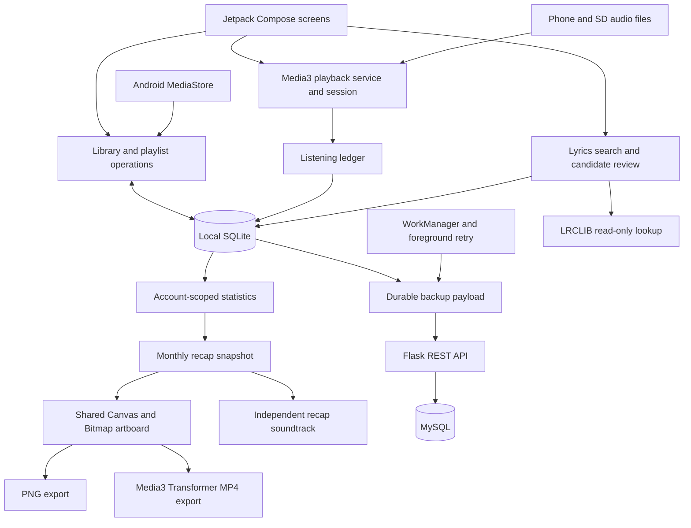

# Architecture

[← Nimbo](../README.md)

Nimbo combines a native Android client with a Python API for accounts and statistical backups. Local media and playback belong to the Android side; the API does not host a streaming catalog.

## Android responsibilities

| Component | Responsibility |
| --- | --- |
| Compose interface | Library, player, metadata, lyrics, appearance, accounts, statistics, and recap navigation. |
| MediaStore integration | Discovers permitted device media and reflects the local collection. |
| Playback service | Owns ExoPlayer and the media session, queue, audio focus, and background controls. |
| SQLite stores | Persist library edits, playlist occurrences, artwork variants, account-scoped listening, pending uploads, and recap snapshots. |
| WorkManager | Schedules daily backup attempts subject to Android scheduling and connectivity. Foreground opportunities also trigger attempts. |
| Recap renderer | Uses frozen account-local content and a shared artboard for preview, PNG, and video generation. |
| Session storage | Protects the local session token using Android Keystore. |

SQLite is managed through SQLiteOpenHelper. SharedPreferences stores preferences. The project does not depend on Room or DataStore.

## API responsibilities

Flask exposes REST/JSON account and statistical backup operations. Gunicorn runs the service; PyMySQL connects it to MySQL, with Docker used for deployment packaging. Android communicates through HttpURLConnection.

The server stores hashed session tokens and scrypt password hashes with salts, applies rate limits, and validates owner, device, month, revision, and generation boundaries. These are implementation controls, not a claim of independent security certification.

## Data boundaries

| Data | Device | Statistical backup API |
| --- | --- | --- |
| Audio files and file paths | Yes | No |
| Lyrics and artwork | Yes | No |
| Library metadata edits | Yes | Only minimal metadata needed for statistics |
| Listening history and aggregates | Yes, scoped by account | Statistical backup payloads |
| Monthly recap snapshots | Local account archives | Not uploaded as media |

Lyrics lookup sends the metadata needed for matching, such as title, artist, album, and duration. It does not send audio, file paths, or account credentials to the lyrics provider.

## Lifecycle and failure handling

Screen recreation does not own playback. A pending backup survives process restarts and response loss; its payload stays stable until acknowledged. Account activation changes the statistical owner, and synchronization checks the session epoch before accepting responses. Remote restored history is not counted as new listening to upload again.

PNG export uses the recap artboard directly. MP4 export uses Media3 Transformer and requires device codec support. Its soundtrack has its own playback path, and closing a recap resumes the original queue entry only if that entry was playing and has not changed externally.
