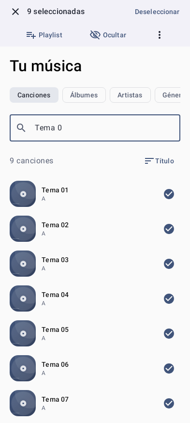
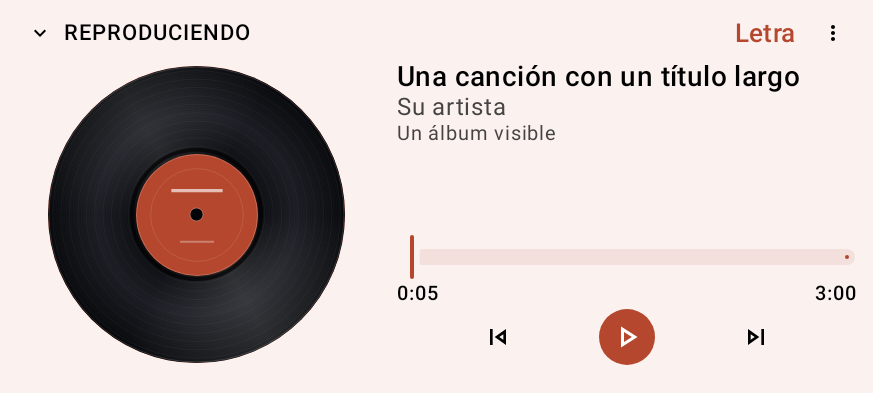
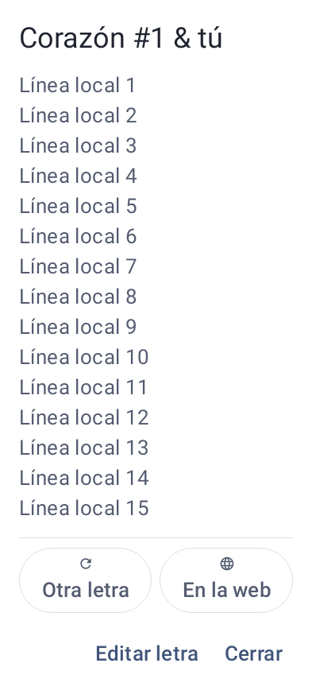

# Product tour

[← Nimbo Player](../README.md)

These are actual application renders generated by the project's UI tests. Data, titles, artists, and artwork are fictional fixtures. The gallery combines reviewed versions to show specific features. These images predate the Nimbo Player 0.8.1 branding update and are retained unchanged with their original version labels.

## Playback and library

  
  &nbsp;
  

**Player: 0.7.1, 200% text. Library selection: 0.6.1.** The library supports local collections, favorites, folders, and bulk actions. The player provides the queue and transport controls while its service maintains playback outside the screen lifecycle.

### Landscape at large text

**0.7.1, 200% text.** The landscape layout separates artwork and controls rather than simply shrinking the portrait composition.

## Appearance and lyrics

  
  &nbsp;
  

**Appearance: 0.6.1. Lyrics: 0.7.1, 200% text.** Themes combine typography, palettes, wallpapers, and artwork choices. Lyrics remain editable locally, with search and candidate review for assisted lookup. The displayed lines are invented test content.

## Listening insights

**0.8.0.** Summary, songs, and artists use separate views. The overview presents active listening time and rankings; histories are separated by account. Values shown here are test fixtures, not product usage metrics.

## Monthly recap

  
  &nbsp;
  

**0.8.0.** Two of the seven story cards: the opening and closing summary. Recaps preserve monthly snapshots and thumbnails, support manual advance with reduced motion, and export as PNG or MP4. Shared media uses the same artboard as the preview. The artwork and one-minute totals are deliberately synthetic.

[View asset provenance →](assets/README.md)
